<p align="center">
  
</p>

<h1 align="center">AssertLane</h1>

<p align="center">
  <strong>Turn test activity into evidence for release decisions.</strong><br/>
  Track projects, test cases, execution runs and imported results, connecting recorded test activity to release review.
</p>

<p align="center">
  <a href="https://assertlane.netlify.app/"></a>
  <a href="LICENSE"></a>
  
  
  
</p>

<p align="center">
  <a href="#overview">Overview</a> ·
  <a href="#implemented-capabilities">Capabilities</a> ·
  <a href="#architecture">Architecture</a> ·
  <a href="#run-locally">Run locally</a> ·
  <a href="#tests-and-automation">Tests & automation</a> ·
  <a href="#security-and-release-readiness-audit">Audit</a>
</p>

---

> [!IMPORTANT]
> **Deployment status: frontend preview is published; the full-stack application is not production-ready.** The committed React UI currently calls `http://127.0.0.1:8000` directly, the FastAPI API has no authentication or authorization, and the backend uses a local SQLite file. A deployed browser's `127.0.0.1` points to the visitor's own device—not a hosted AssertLane API. Treat the Netlify URL as a frontend preview until the deployment and security blockers below are fixed.

## Overview

AssertLane is a small quality-engineering MVP for organizing the evidence behind testing work. It contains a FastAPI API, SQLAlchemy models backed by SQLite, Alembic migration files, a minimal React dashboard, pytest API tests, and a Playwright demo test with a JSON report-import helper.

The intent is to distinguish a product assertion failure from an automation or environment error, retain a link between a result and the test-case version recorded at execution time, and make test activity easier to review. The current implementation is a foundation for that workflow—not yet a complete test-management or release-gating product.

## Implemented capabilities

| Area | Current implementation |
|---|---|
| Backend API | FastAPI application with a health endpoint and CRUD endpoints for projects, suites, cases, test runs and results |
| Data model | SQLAlchemy models and Alembic migrations for projects, test suites, test cases, runs and results |
| Result tracking | Result states include Passed, Failed, Skipped, Blocked and Error |
| Case versioning | Updates to case steps, expected result or preconditions increment a version; a result records that version number |
| Result import | API endpoint accepts structured report results and returns imported/failed counts |
| Frontend | React + TypeScript page for backend status plus creating and listing projects |
| Browser automation | One Playwright demo-page test, JSON reporter configuration and a helper that maps tagged test IDs to AssertLane result imports |
| Local demo | FastAPI serves a small `/demo` page used by the Playwright test |
| API exploration | FastAPI's generated OpenAPI docs are available at `/docs` when the local backend is running |

**UI scope matters:** the current frontend only exposes project creation/listing. Suite, case, run and result operations exist as API routes, but complete management screens for those workflows are not implemented in the visible UI.

## Architecture

~~~mermaid
flowchart LR
    subgraph LocalDev["Local development"]
      UI["React + TypeScript UI"] -->|"HTTP calls to 127.0.0.1:8000"| API["FastAPI"]
      PW["Playwright demo test"] --> DEMO["/demo"]
      API --> CRUD["CRUD and import services"]
      CRUD --> ORM["SQLAlchemy models"]
      ORM --> DB[("SQLite file")]
      REPORT["Playwright JSON report"] --> BRIDGE["push_results.js"]
      BRIDGE -->|"POST /api/runs/{id}/import"| API
    end
    HOSTED["Netlify frontend preview"] -. "Current UI still targets browser-local 127.0.0.1" .-> LOOPBACK["Visitor's own device"]
    style HOSTED fill:#15324B,stroke:#60A5FA,color:#FFFFFF
    style LOOPBACK fill:#3F2630,stroke:#FB7185,color:#FFFFFF
~~~

The diagram describes the source as currently committed. It does **not** imply that a remote API is deployed or that the public Netlify page can communicate with a hosted backend.

## Technology stack

| Layer | Technology |
|---|---|
| Frontend | React 19, TypeScript, Vite, Tailwind CSS, Axios |
| Backend | Python, FastAPI, Pydantic, SQLAlchemy |
| Local persistence | SQLite |
| Schema migrations | Alembic |
| API testing | pytest, FastAPI TestClient, HTTPX |
| Browser automation | Playwright for Chromium |
| Frontend deployment | Netlify static-site preview |
| License | MIT |

## Run locally

The instructions below are for the repository's local-development setup. The frontend-to-backend browser connection needs CORS and configurable API-origin work before the UI can be expected to operate end-to-end from a separate origin.

### 1. Start the backend

Requirements: a supported Python installation and pip.

**Windows PowerShell**

```powershell
cd backend
py -m venv .venv
.\.venv\Scripts\Activate.ps1
python -m pip install -r requirements.txt
alembic upgrade head
uvicorn main:app --reload --host 127.0.0.1 --port 8000
```

The API should be available locally at:

- Health check: `http://127.0.0.1:8000/api/health`
- Interactive API documentation: `http://127.0.0.1:8000/docs`
- Playwright demo page: `http://127.0.0.1:8000/demo`

The database URL is currently hard-coded to `sqlite:///./assertlane.db` in the backend. Run the commands from the `backend/` directory so that the relative SQLite file and migration configuration use the expected working directory.

### 2. Start the frontend

In a second terminal:

```powershell
cd frontend
npm ci
npm run dev
```

Vite prints the local development URL. The app currently hard-codes its API origin to `http://127.0.0.1:8000`. FastAPI does not currently configure CORS middleware, so browser requests from Vite or Netlify are expected to be blocked. The frontend/API origin must be made configurable and the backend must allow only the intended origins before this becomes an integrated browser workflow.

### 3. Run backend tests

From the backend directory, with the backend dependencies installed:

```powershell
cd backend
python -m pytest
```

The repository contains four pytest modules covering project CRUD, suite/case workflows, run/result workflows, and report import. The current tests share a relative `test.db` file and do not fully isolate/clean their database state. The tests were reviewed as source during this audit; they were **not executed in this audit session**, so no passing-test claim is made here.

## Tests and automation

The `automation/` directory contains a Playwright configuration and one demo test. To prepare the browser runner locally:

```powershell
cd automation
npm ci
npx playwright install chromium
npx playwright test
```

This requires the local FastAPI backend to be running. Playwright writes `automation/results.json` according to `playwright.config.ts`.

### Import the Playwright report

The helper `automation/push_results.js` expects both a report file and an existing AssertLane test run ID:

```powershell
$env:ASSERTLANE_RUN_ID = "<existing-test-run-uuid>"
node .\push_results.js
```

Run the helper from the `automation/` directory, after the Playwright report exists. The demo test's `@TID-...` annotation must correspond to a test-case ID that already exists in the same local database, and the run ID must also exist. The integration helper currently posts to `127.0.0.1:8000`; it is a local-development bridge, not a remote CI integration.

**Important:** `automation/package.json` still defines `npm test` as a placeholder that exits with an error. Use the explicit `npx playwright test` command above rather than assuming `npm test` works. No GitHub Actions workflow is currently committed, so there is no repository CI run or CI-backed passing status to report.

## API surface

| Resource | Representative routes |
|---|---|
| Health | `GET /api/health` |
| Projects | `/api/projects/`, `/api/projects/{project_id}` |
| Suites | `/api/projects/{project_id}/suites/`, `/api/suites/{suite_id}` |
| Cases | `/api/suites/{suite_id}/cases/`, `/api/cases/{case_id}` |
| Test runs | `/api/projects/{project_id}/runs/`, `/api/runs/{run_id}` |
| Test results | `/api/runs/{run_id}/results/` |
| Imported results | `POST /api/runs/{run_id}/import` |
| Demo target | `GET /demo` |

The `/docs` endpoint exposes the generated OpenAPI interface when the local API is running.

## Security and release-readiness audit

A source-based audit of the current `main` branch found the following blockers. These should be addressed before treating AssertLane as a public, multi-user service or entering real test data.

| Severity | Finding | Why it matters |
|---|---|---|
| **Critical before public API exposure** | No authentication or authorization on API routes | Anyone who can reach the API can create, read, update or delete records. Do not expose this backend publicly until access controls exist. |
| **High** | Frontend hard-codes `http://127.0.0.1:8000`; no CORS middleware is configured | The Netlify browser does not talk to a hosted AssertLane API through this URL. Separate-origin browser calls are also blocked without an intentional CORS policy. |
| **High** | SQLite URL is hard-coded and there is no backend deployment configuration in the repository | Local SQLite is suitable for a local MVP; it is not a designed durable multi-user production storage configuration. |
| **High** | Result/run integrity is not fully enforced | Result creation checks that the run and case exist, but does not verify that the selected case belongs to the same project's run. |
| **High** | Historical-evidence guarantees are incomplete | A result stores a case version number, but not a full immutable snapshot of the case definition. Deleting a case or run cascades into result deletion. |
| **High** | No committed CI workflow; automation `npm test` is a failing placeholder | The presence of test files and a Playwright config is not proof that tests run in CI or that the current branch is green. |
| **Medium** | Test database isolation needs work | Test modules use the same relative `test.db` and don't consistently reset state, which can make tests order-dependent or leak state between runs. |
| **Medium** | Input/lifecycle constraints need tightening | Imported result batches are not bounded, pagination parameters are not constrained, and run status transitions are not enforced as a state machine. |
| **Medium** | Some update schemas allow explicit null for fields backed by non-null database columns | Invalid updates may reach the database and become server errors instead of a clean validation response. |
| **Medium** | Playwright bridge assumes local state and does not make remote delivery reliable | The helper uses a loopback URL and logs caught errors; it is not yet a robust, authenticated CI-to-server reporter. |

### Recommended order of work

1. **Fix deployment architecture:** provide an environment-driven API base URL, deploy the API on a backend-capable host, configure an explicit CORS allowlist, and verify the live end-to-end flow.
2. **Add security controls before public backend exposure:** authentication, authorization, ownership checks for every resource, rate/body limits, safe secrets management, and a deployment-specific threat review.
3. **Protect data integrity:** ensure a test case and run belong to the same project; validate result batches and legal run-state transitions; define whether old evidence is immutable or deletable and implement that policy.
4. **Make evidence genuinely reproducible:** store historical case-definition snapshots or revisions, isolate test databases, add failure-path tests and a repeatable test setup.
5. **Add CI:** use a real Playwright test command, configure backend and frontend checks, run migrations/tests against a clean database, and publish an honest status badge only after checks are configured.

The external Netlify page could not be independently inspected by the audit browsing path in this session. Deployment conclusions above are therefore based on the committed frontend and backend configuration, not a claim that a live browser test was performed.

## Roadmap

- [ ] Configure a deployable API base URL and hosting-compatible backend
- [ ] Add explicit CORS policy and an authenticated authorization model
- [ ] Build the suite, case, run and result views in the frontend
- [ ] Enforce project/run/case relationships and legal state transitions
- [ ] Preserve reconstructable historical test-case revisions
- [ ] Bound report imports and validate pagination/input constraints
- [ ] Isolate tests and configure automated CI
- [ ] Replace the placeholder `npm test` script with a real test command
- [ ] Make result upload configurable, authenticated, and failure-aware
- [ ] Add deployment, backup, migration and operational documentation

## Repository layout

```text
.
├── backend/
│   ├── main.py                 # FastAPI routes
│   ├── models.py               # SQLAlchemy data models
│   ├── schemas.py              # Pydantic request/response schemas
│   ├── crud.py                 # Database operations
│   ├── database.py             # SQLite engine/session
│   ├── migrations/             # Alembic migrations
│   └── tests/                  # pytest API tests
├── frontend/
│   ├── src/App.tsx             # Current project list/create UI
│   └── package.json
├── automation/
│   ├── tests/demo.spec.ts      # Playwright demo test
│   ├── playwright.config.ts    # JSON report configuration
│   └── push_results.js         # Local report-to-API bridge
├── docs/
│   ├── PROJECT_STATE.md
│   └── DECISIONS.md
├── assets/
│   └── assertlane-banner.svg
└── LICENSE
```
---

## Creator, Developer & Maintainer

**Created, designed, developed, and maintained by [Nurul Faiyaz](https://github.com/tracolerd).**

This project is independently built and maintained by Nurul Faiyaz. The project's design, implementation, and documentation are his work.

<p align="center">
  <a href="https://www.facebook.com/faiyaz.888"></a>
  <a href="https://www.instagram.com/tracolerd"></a>
  <a href="https://www.linkedin.com/in/faiyaz-xyz"></a>
  <a href="https://x.com/faiyaz_explores"></a>
  <a href="https://github.com/tracolerd"></a>
  <a href="mailto:scrollfaiyaz@gmail.com"></a>
  <a href="https://nurul-faiyaz.netlify.app/"></a>
</p>

<p align="center">
  <a href="https://www.facebook.com/faiyaz.888">Facebook</a> ·
  <a href="https://www.instagram.com/tracolerd">Instagram</a> ·
  <a href="https://www.linkedin.com/in/faiyaz-xyz">LinkedIn</a> ·
  <a href="https://x.com/faiyaz_explores">X / Twitter</a> ·
  <a href="https://github.com/tracolerd">GitHub</a> ·
  <a href="mailto:scrollfaiyaz@gmail.com">Email</a> ·
  <a href="https://nurul-faiyaz.netlify.app/">Website</a>
</p>

## License

MIT. See [LICENSE](LICENSE).

## Frontend API origin configuration

The React client reads its API base URL from `VITE_API_BASE_URL`. For local development, copy `frontend/.env.example` to `frontend/.env.local` and keep the local FastAPI URL. A production build requires `VITE_API_BASE_URL` to be set explicitly; a hosted browser cannot reach a developer's `127.0.0.1`.

The API's browser-origin allowlist is configured separately with `ASSERTLANE_CORS_ORIGINS` on the backend. CORS is not authentication or authorization; this MVP still must not be exposed to untrusted users until the security gaps listed above are resolved.

---

<p align="center"><sub>Portfolio catalog · Project 05 of 22 · <a href="https://github.com/tracolerd">Nurul Faiyaz</a></sub></p>
